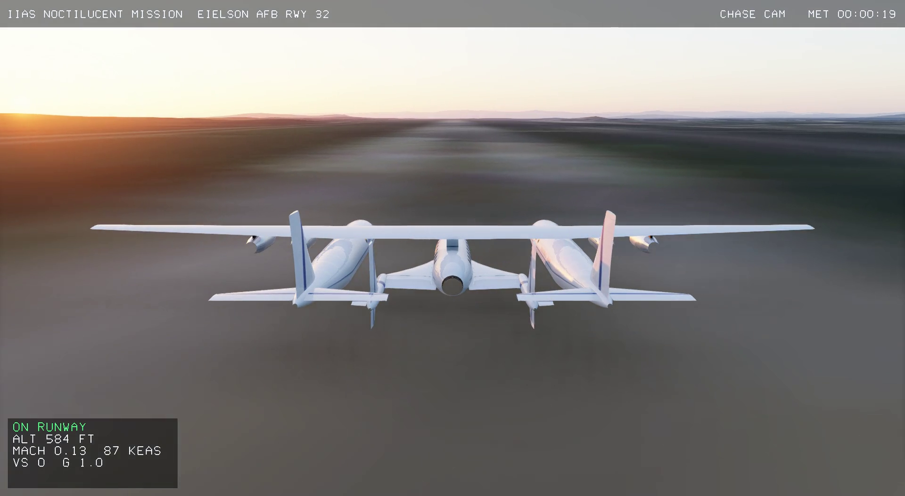
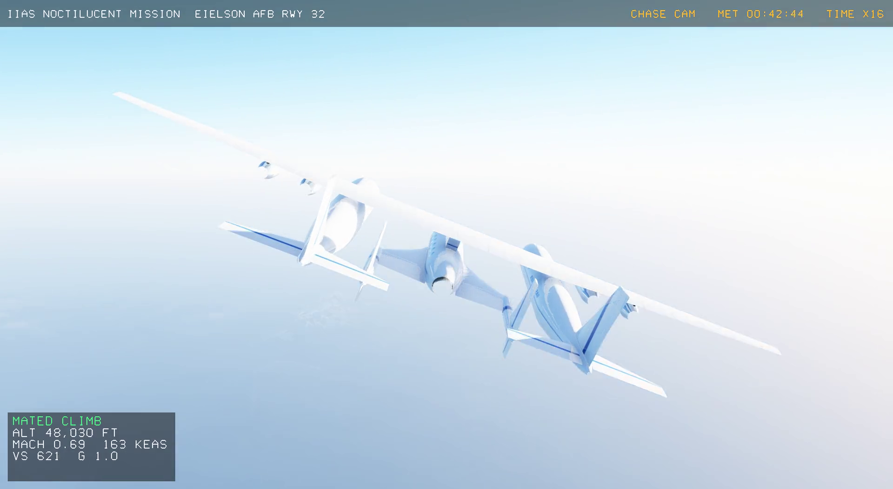
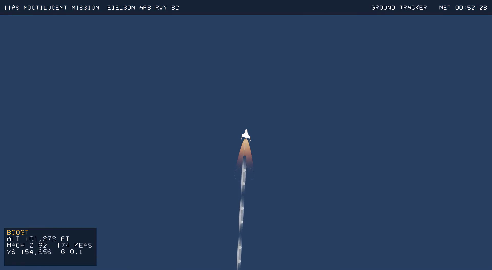
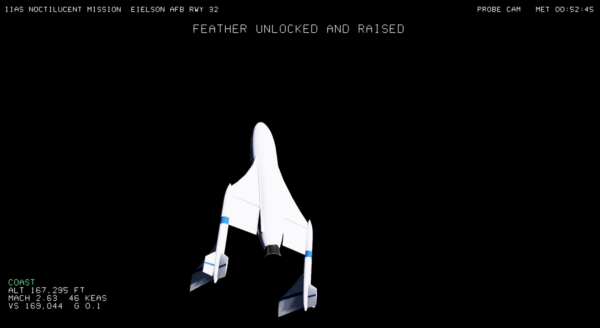
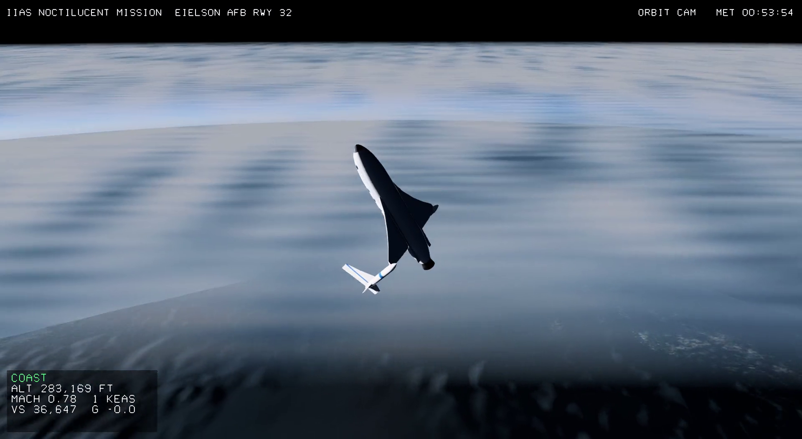
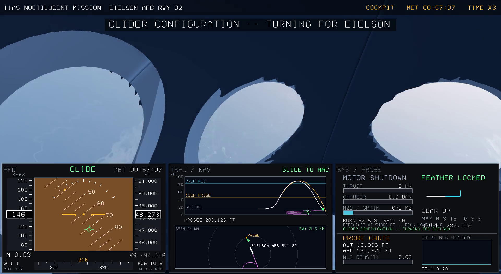
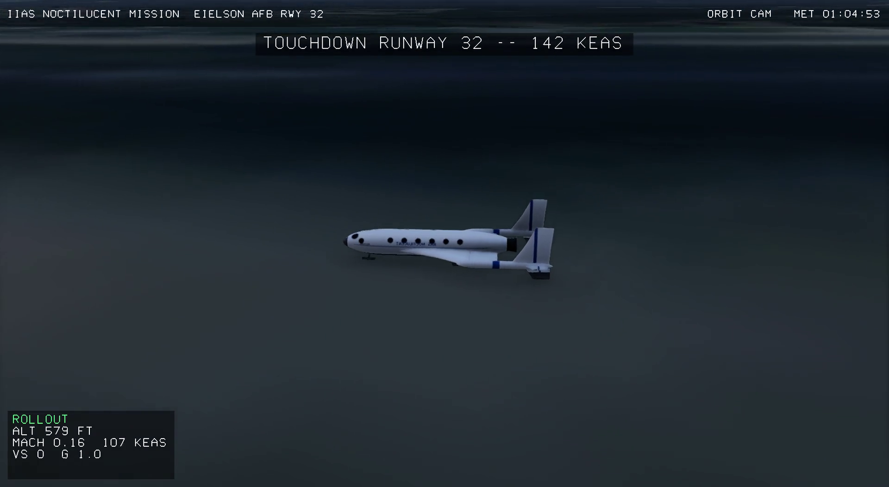
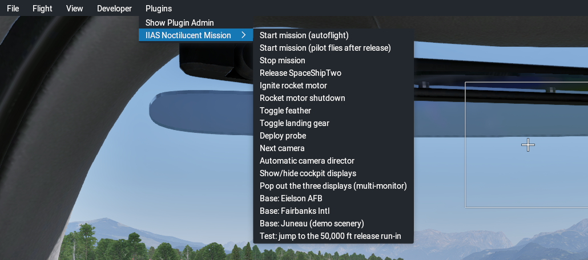
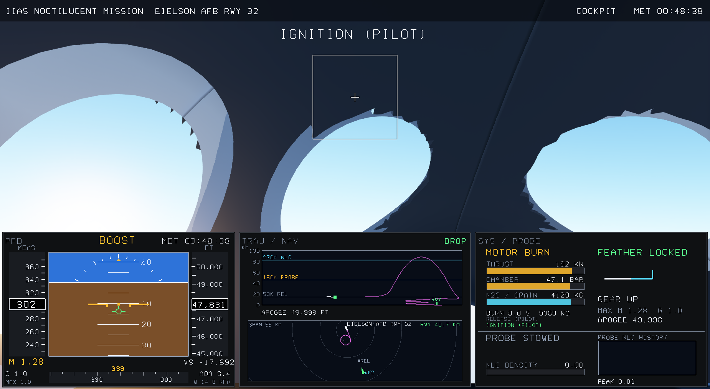

# IIAS Noctilucent Mission for X-Plane 12

**Fly a SpaceShipTwo research mission to the noctilucent clouds at the edge
of space, in X-Plane 12.**


▶ **[Watch the full mission video](https://github.com/ammarjmahmood/xplane-iias-noctilucent-mission/releases/latest)**
(`iias-noctilucent-mission-eielson.mp4` under *Assets* on the Releases page).

This add-on (a "plugin") flies a whole suborbital science flight:

| | |
|---|---|
|  | **1. Takeoff.** The WhiteKnightTwo carrier plane takes off from **Eielson Air Force Base**, near Fairbanks, Alaska, with SpaceShipTwo hanging underneath. |
|  | **2. Climb.** The pair climbs to **50,000 ft**. This part is sped up on screen. |
|  | **3. Release and rocket boost.** SpaceShipTwo drops free, lights its rocket and climbs almost straight up to **Mach 3**. |
|  | **4. Probe.** At **150,000 ft** a science probe is released (this is its own camera, watching SpaceShipTwo climb away). It flies its own path and measures the clouds. |
|  | **5. Noctilucent clouds.** Ship and probe pass through the cloud layer at **270,000 ft**, built from **real NASA satellite data**, and the ship tops out near **289,000 ft**. |
|  | **6. Reentry and glide.** The tail "feathers" up for a safe fall back into the atmosphere, then folds down, and the ship glides home (cockpit view with its three displays). |
|  | **7. Landing.** Touchdown and rollout on Eielson's runway 32. |

The flight takes about **14 minutes** from start to stop. It can fly itself
while cameras switch between cockpit, chase, wingman, carrier, probe and
runway views. Alternatively you can take the controls after release.

---

## Contents

1. [Set it up on Windows: step by step](#set-it-up-on-windows-step-by-step) ← **start here**
2. [Start the mission](#start-the-mission)
3. [If something doesn't work](#if-something-doesnt-work)
4. [The cockpit and its three displays](#the-cockpit-and-its-three-displays)
5. [All menu items and controls](#all-menu-items-and-controls)
6. [Giving someone access to this private repository](#giving-someone-access-to-this-private-repository)
7. [For developers: building from source](#for-developers-building-from-source)
8. [How it works, data sources and credits](#how-it-works)

---

## Set it up on Windows: step by step

No programming is needed. You only download one file and copy one folder.

### What you need

- A Windows 10 or 11 PC that runs X-Plane 12.
- **X-Plane 12** installed (from Steam or from x-plane.com). The full
  version is best; the free demo also works, see
  [Limitations](#limitations).
- Access to this GitHub page. It is private, so the owner has to invite
  your GitHub account first; see
  [Giving someone access](#giving-someone-access-to-this-private-repository).

### Step 1: Download the plugin

1. On this GitHub page, find **Releases** in the right-hand column and
   click the latest one (for example **IIAS Noctilucent Mission v1.0**).
   Direct link: <https://github.com/ammarjmahmood/xplane-iias-noctilucent-mission/releases/latest>
2. Under **Assets**, click
   **`IIAS-Noctilucent-Mission-xplane12-linux-windows.zip`** (about 75 MB).
   It goes to your **Downloads** folder.

> Don't use the green **Code → Download ZIP** button. That gives you the
> source code, not the ready-to-use plugin.

### Step 2: Unzip it

1. Open your **Downloads** folder.
2. Right-click the ZIP file and choose **Extract All… → Extract**.
3. A new folder opens with a folder called **`NoctilucentClouds`** inside.
   That folder is the plugin.

### Step 3: Find your X-Plane 12 folder

- **Steam:** open Steam → **Library** → right-click **X-Plane 12** →
  **Manage** → **Browse local files**. A window opens in the X-Plane 12
  folder.
- **Installed from x-plane.com:** it is usually `C:\X-Plane 12`, or
  `X-Plane 12` on your Desktop. Look for the folder that contains
  **X-Plane.exe**.

### Step 4: Copy the plugin into X-Plane

1. In the X-Plane 12 folder, open **`Resources`**, then **`plugins`**.
2. Drag the **`NoctilucentClouds`** folder from Step 2 into this
   `plugins` folder.

When you're done it should look exactly like this:

```
X-Plane 12
└── Resources
    └── plugins
        └── NoctilucentClouds        ← the folder you copied
            ├── 64
            │   ├── win.xpl          ← the plugin itself
            │   └── lin.xpl
            ├── assets
            └── README.md
```

> **The most common mistake** is one folder too many:
> `plugins\NoctilucentClouds\NoctilucentClouds\64`. If you see that, move
> the inner `NoctilucentClouds` folder up one level.

That's the installation. You only do this once.

---

## Start the mission

1. Start **X-Plane 12**.
2. Click **New Flight**. Pick **any aircraft** and **any airport**, then
   click **Start Flight**. The plugin moves you to Alaska and swaps in its
   own spaceship.
3. When the flight has loaded, move the mouse to the **top of the screen**
   to show X-Plane's menu bar.
4. Click **Plugins → IIAS Noctilucent Mission → Start mission (autoflight)**.

   

5. Sit back. If X-Plane shows a message box, click **OK**. The mission
   runs on its own: takeoff, climb, release, boost, clouds, reentry and
   landing. Captions at the top of the screen tell you what is happening,
   for example "RELEASE AT 49,998 FT" or "CROSSING NOCTILUCENT CLOUD
   LAYER".

**Useful during the flight:**

- **Plugins → IIAS Noctilucent Mission → Next camera** switches the view
  yourself. **Automatic camera director** hands control back to the
  automatic cameras.
- **Stop mission** ends it at any time and returns you to normal X-Plane.
- **Test: jump to the 50,000 ft release run-in** skips the long climb if
  you just want to see the rocket part.

**Want to fly it yourself?** Choose **Start mission (pilot flies after
release)** instead. The carrier still flies itself to 50,000 ft. Then:

1. **Release** SpaceShipTwo.
2. **Ignite** the rocket and pull back to point nearly straight up.
3. Let the motor burn out, or choose **Rocket motor shutdown**.
4. Raise the **feather** for reentry and lower it again below about
   55,000 ft.
5. Glide back and lower the **gear** before landing.

A joystick is strongly recommended. Without one, X-Plane uses the mouse
position as the stick.

---

## If something doesn't work

| Problem | What to do |
|---|---|
| **No "IIAS Noctilucent Mission" in the Plugins menu** | Check the folder layout in [Step 4](#step-4-copy-the-plugin-into-x-plane), especially the "folder too many" mistake. Then restart X-Plane. |
| **Still missing after fixing the folder** | Open `Resources\plugins\NoctilucentClouds\64`, right-click **win.xpl** → **Properties**. If there is an **Unblock** box at the bottom, tick it, click **OK** and restart X-Plane. |
| **Antivirus or SmartScreen complains about win.xpl** | Allow it. It is built from the source code in this repository and is not digitally signed. |
| **The ground looks like ocean or plain colours** | You are on the free X-Plane demo, which has no Alaska scenery. The plugin then draws its own simple scenery. With the full X-Plane 12 you get the real terrain. |
| **Low frame rate** | In X-Plane go to **Settings → Graphics** and lower **Visual Effects** and **Texture Quality**. |
| **Something else** | Look in `X-Plane 12\Log.txt` for lines starting with `NLC:`. They show what the plugin did. Send that file along with your question. |

---

## The cockpit and its three displays

In the **cockpit** camera, three screens sit under the windows:



| Display | What it shows |
|---|---|
| **PFD** (left) | Attitude ball (blue sky, brown ground) with a green flight-path marker; speed (KEAS) and Mach on the left; altitude on the right; vertical speed, g-force and angle of attack. |
| **TRAJ / NAV** (middle) | **Top:** altitude against distance. Magenta is the plan, white is where the ship actually went, amber is the probe. The 50K, 150K and 270K levels are marked. **Bottom:** a map with the runway, the circle the ship spirals down on before landing, the release point, the carrier and the probe. |
| **SYS / PROBE** (right) | Rocket thrust, chamber pressure, remaining propellant and burn time; feather and landing gear; probe status, height and the cloud density and ice it measures; the latest mission events. |

**Three monitors:**

- To put the three displays on separate screens, choose **Plugins → IIAS
  Noctilucent Mission → Pop out the three displays**. Each display becomes
  its own window that you can drag to any monitor.
- To spread the outside view across three monitors, use X-Plane's own
  **Settings → Graphics → Monitor configuration**. Give each monitor a
  full-screen view with side offsets such as −60°, 0° and +60°.

---

## All menu items and controls

Every menu item is also a **command** you can put on a keyboard key or
joystick button. In X-Plane open **Settings → Keyboard** (or **Joystick**),
search for **`iias/mission`** and assign a key.

| Menu item | Command |
|---|---|
| Start mission (autoflight) | `iias/mission/start_autoflight` |
| Start mission (pilot flies after release) | `iias/mission/start_manual` |
| Stop mission | `iias/mission/stop` |
| Release SpaceShipTwo | `iias/mission/release` |
| Ignite rocket motor / Rocket motor shutdown | `iias/mission/ignite`, `iias/mission/cutoff` |
| Toggle feather / Toggle landing gear | `iias/mission/feather`, `iias/mission/gear` |
| Deploy probe | `iias/mission/deploy_probe` |
| Next camera / Automatic camera director | `iias/mission/camera_next`, `iias/mission/camera_auto` |
| Show/hide cockpit displays | `iias/mission/toggle_displays` |
| Pop out the three displays | `iias/mission/popout_displays` |
| Base: Eielson AFB / Fairbanks Intl / Juneau | `iias/mission/base_eielson`, `base_fairbanks`, `base_juneau` |
| Test: jump to the 50,000 ft release run-in | `iias/mission/jump_to_release` |

**Probe data:** each flight writes
`Resources\plugins\NoctilucentClouds\probe_samples.csv`, a spreadsheet you
can open in Excel. It has one row every half second for the ship and the
probe: time, latitude/longitude, altitude, cloud density, ice-water content
(µg/m²) and whether it was inside the cloud layer.

---

## Giving someone access to this private repository

1. The person creates a free account at <https://github.com>.
2. The owner opens this repository on GitHub → **Settings** →
   **Collaborators** → **Add people**, enters their GitHub username or email
   and sends the invite.
3. The person accepts the invite from their email or GitHub notifications.
   Then they can follow [Step 1](#step-1-download-the-plugin).

---

## For developers: building from source

Most people only need the ready-made ZIP above. To change the code or
rebuild everything:

### Windows

1. Install [Git](https://git-scm.com/download/win),
   [Visual Studio 2022 Community](https://visualstudio.microsoft.com/) with
   the **Desktop development with C++** workload (includes CMake), and
   [Python 3.10+](https://www.python.org/downloads/windows/). Tick **Add
   python.exe to PATH**.
2. Open **Developer PowerShell for VS 2022**:

   ```powershell
   git clone https://github.com/ammarjmahmood/xplane-iias-noctilucent-mission.git
   cd xplane-iias-noctilucent-mission
   ```

3. Download the **X-Plane SDK 4.3.0** from
   <https://developer.x-plane.com/sdk/plugin-sdk-downloads/> and unzip it so
   that `third_party\sdk\SDK\CHeaders\XPLM\XPLMPlugin.h` exists.
4. Generate the art and data (once):

   ```powershell
   py -m pip install pillow numpy scipy
   py tools\fetch_aim.py            # NASA noctilucent-cloud data
   py tools\generate_assets.py      # cloud layer
   py tools\generate_vehicles.py    # SpaceShipTwo, WhiteKnightTwo, plume, probe, smoke
   py tools\generate_terrain.py     # fallback Eielson scenery (about 6 minutes of downloads)
   ```

5. Build and test:

   ```powershell
   cmake -S . -B build -A x64
   cmake --build build --config Release
   ctest --test-dir build -C Release
   ```

   The plugin folder is `build\NoctilucentClouds\`. Copy it to
   `X-Plane 12\Resources\plugins\`.

### Linux

```bash
sudo apt install build-essential cmake python3-pip
pip install pillow numpy scipy
python3 tools/fetch_aim.py && python3 tools/generate_assets.py
python3 tools/generate_vehicles.py && python3 tools/generate_terrain.py
cmake -S . -B build && cmake --build build && ctest --test-dir build
cp -r build/NoctilucentClouds "$HOME/X-Plane 12/Resources/plugins/"
```

`tools/build_windows_cross.sh` builds `win.xpl` on Linux with MinGW-w64.
On hybrid-graphics laptops, start X-Plane with
`VK_ICD_FILENAMES=/usr/share/vulkan/icd.d/nvidia_icd.json`.

### Helper scripts

| Script | Purpose |
|---|---|
| `tools/xpcmd.py` | Send X-Plane commands over its UDP port, e.g. `iias/mission/start_autoflight` |
| `tools/xpref.py` | Read or set datarefs over UDP |
| `tools/xp_restart.sh` | Reinstall the plugin and restart the sim (Linux) |
| `tools/edit_video.py` | Cut a highlight video from a screen recording using the event times in `Log.txt` |
| `tools/make_aircraft.py` | Build the invisible container aircraft (the plugin also does this itself) |

### Releasing a new version

```bash
cmake --build build && tools/build_windows_cross.sh
(cd build && zip -r ../IIAS-Noctilucent-Mission-xplane12-linux-windows.zip NoctilucentClouds)
gh release create v1.1 IIAS-Noctilucent-Mission-xplane12-linux-windows.zip --notes "..."
```

---

## How it works

- **Uses X-Plane's built-in features wherever it can.** X-Plane supplies
  the world: terrain and airports (Eielson AFB is part of X-Plane 12's
  global scenery), sky, atmosphere, lighting, weather, time of day and
  camera rendering. The plugin adds only what X-Plane doesn't have: the two
  vehicles, the rocket flight, the feather, the probe and the 270,000 ft
  cloud layer.
- **Flight model** (`src/flight.*`):
  - point-mass physics with quaternion attitude and the US Standard
    Atmosphere 1976
  - Mach-dependent lift and drag
  - a ~205 kN hybrid rocket with propellant burn-off
  - feathered blunt-body drag for a stable belly-first reentry
  - reaction-control attitude above the sensible atmosphere

  X-Plane's own aircraft physics can't change shape mid-flight the way the
  feather does, so the plugin positions the aircraft itself.
- **Autoflight** (`src/autopilot.*`):
  - takeoff, climb orbit, aligned run-in and release at 50,000 ft
  - a rocket pitch program, with shutdown when the predicted apogee
    reaches the target
  - probe release at 150,000 ft
  - feather, reentry and defeather
  - a heading-alignment-circle approach, flare and rollout
- **Graphics** (`src/plugin.cpp`): vehicles, plume, smoke, probe and
  clouds are X-Plane object instances. Exposure is adjusted for the black
  sky of space.
- **Displays** (`src/avionics.*`): drawn with OpenGL in X-Plane's 2-D
  layer. They can also be popped out into separate windows.
- **Test** (`tests/mission_sim.cpp`): flies the entire mission without
  X-Plane. It checks the apogee, the probe's pass through the clouds and
  the landing spot.

## Data sources and credits

- **Noctilucent clouds:** NASA **AIM** satellite, CIPS camera (LASP /
  Hampton University), Level 2 cloud measurements. Public domain.
  <https://cdaweb.gsfc.nasa.gov/pub/data/aim/cips/>
  - The cloud layer shows the measured brightness from one real 2019
    satellite pass.
  - The probe reports that pass's measured ice-water content.
  - Real noctilucent clouds are rare and faint as far south as Fairbanks
    (64.7° N), so the 350 km patch comes from further north and is moved
    over the mission area. See `assets/nlc_source.txt`.
- **Fallback scenery imagery:** Sentinel-2 cloudless, <https://s2maps.eu>,
  by EOX IT Services GmbH (contains modified Copernicus Sentinel data).
  CC BY-NC-SA 4.0.
- **Fallback scenery elevation:** AWS Terrain Tiles (Mapzen/Tilezen; SRTM,
  USGS 3DEP, GMTED2010).
- **Vehicle figures:** public figures for SpaceShipTwo and WhiteKnightTwo,
  including the
  [Virgin Galactic Public Payload User Guide](https://press.virgingalactic.com/asset/public-payload-user-guide-2024).
  The 3-D models, textures and markings were made for this project; no
  manufacturer files or logos are used.
- **Background:** [NASA: polar mesospheric clouds](https://science.nasa.gov/earth/earth-observatory/polar-mesospheric-clouds-south-pacific-ocean-80217/),
  [IIAS Project PoSSUM](https://astronauticsinstitute.org/center/flight-research).

## Limitations

- **Free demo:** the X-Plane 12 demo has no terrain for interior Alaska.
  The plugin detects this and draws its own Eielson scenery. With the full
  X-Plane 12 the real built-in scenery is used instead.
- **Not certified:** this is a training and visualisation simulation built
  from public figures. It is not certified and not manufacturer data.
- **Clouds are relocated:** the cloud layer is real measured structure,
  moved over the mission area as described above.
- **Windows build not tested on Windows:** the Windows plugin is
  cross-compiled and was not run on Windows during development. Please
  report any problems.

## Repository layout

```
src/            plugin, flight model, autoflight, displays
tests/          headless full-mission test
tools/          art/data generators, download scripts, build and test helpers
assets/         models and textures shipped with the plugin
screenshots/    stills from a recorded mission
docs/img/       pictures used in this README
```
