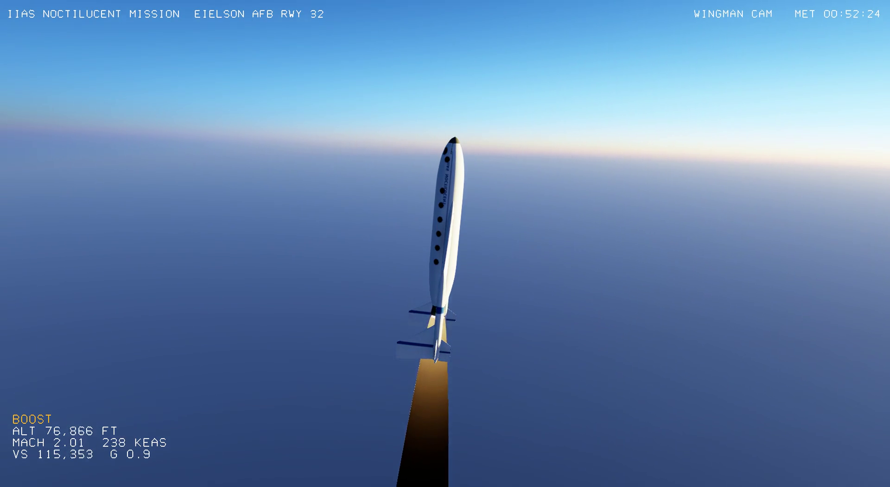

# IIAS Noctilucent Mission for X-Plane 12

An X-Plane 12 plugin that flies a complete air-launched suborbital research
mission:

1. **WhiteKnightTwo** carries **SpaceShipTwo** off **Eielson AFB runway 32**
   (Fairbanks, Alaska) and climbs to **50,000 ft**.
2. SpaceShipTwo is released, lights its hybrid rocket motor and pulls up to
   near-vertical: about a 60 s burn, Mach 3.1.
3. At **150,000 ft** a research probe is ejected and flies its own arc.
4. Ship and probe cross a **noctilucent cloud layer at ~270,000 ft
   (82.3 km)** built from **real NASA AIM satellite measurements**. The probe
   logs cloud density and ice-water content.
5. Apogee is ~289,000 ft. Then a feathered reentry (~3.5 g), defeather at
   55,000 ft, a heading-alignment-circle approach and landing on runway 32.

It runs fully automatically ("autoflight") with a camera director: cockpit,
chase, wingman, carrier, probe, flyby, orbit, ground-tracker and runway
cameras. Alternatively you can fly SpaceShipTwo yourself after release. A
three-display glass cockpit shows flight, trajectory/navigation and systems
data, and the displays can be popped out onto three monitors.



---

## Contents

- [Quick start on Windows (no building)](#quick-start-on-windows-no-building)
- [Flying the mission](#flying-the-mission)
- [Cockpit and three-monitor setup](#cockpit-and-three-monitor-setup)
- [Building from source on Windows](#building-from-source-on-windows)
- [Building on Linux](#building-on-linux)
- [Regenerating the art and data](#regenerating-the-art-and-data)
- [How it works](#how-it-works)
- [Data sources and credits](#data-sources-and-credits)
- [Limitations](#limitations)
- [Repository layout](#repository-layout)

---

## Quick start on Windows (no building)

You need **X-Plane 12** (full version recommended; the free demo also works,
see [Limitations](#limitations)).

1. Download `IIAS-Noctilucent-Mission-xplane12-linux-windows.zip` from this
   repository's **Releases** page.
2. Unzip it. You get a folder called `NoctilucentClouds`.
3. Copy that folder into your X-Plane plugins folder:

   ```
   C:\X-Plane 12\Resources\plugins\NoctilucentClouds\
   ```

   It should contain `64\win.xpl`, `assets\` and `README.md`.
4. Start X-Plane 12 and start any flight (any aircraft, any airport).
5. In the top menu choose **Plugins → IIAS Noctilucent Mission → Start
   mission (autoflight)**.

On first use the plugin creates an invisible container aircraft,
`Aircraft\IIAS Noctilucent\SpaceShipTwo`. It then moves you to Eielson AFB,
sets late-summer Alaskan twilight and clear weather, and starts the mission.
The whole flight takes about 14 minutes.

> **Tip:** If Windows SmartScreen or antivirus flags the unsigned
> `win.xpl`, allow it. It is built from the source in this repository.

---

## Flying the mission

Plugins → **IIAS Noctilucent Mission**:

| Menu item | Command (bindable to keys/joystick buttons) |
|---|---|
| Start mission (autoflight) | `iias/mission/start_autoflight` |
| Start mission (pilot flies after release) | `iias/mission/start_manual` |
| Stop mission | `iias/mission/stop` |
| Release / Ignite / Shutdown | `iias/mission/release`, `ignite`, `cutoff` |
| Feather / Gear / Deploy probe | `iias/mission/feather`, `gear`, `deploy_probe` |
| Next camera / automatic camera director | `iias/mission/camera_next`, `camera_auto` |
| Show/hide cockpit displays | `iias/mission/toggle_displays` |
| Pop out the three displays | `iias/mission/popout_displays` |
| Base: Eielson AFB / Fairbanks Intl / Juneau | `iias/mission/base_eielson`, `base_fairbanks`, `base_juneau` |
| Test: jump to the 50,000 ft release run-in | `iias/mission/jump_to_release` |

To bind a command, use X-Plane's **Settings → Keyboard** (or **Joystick**)
and search for `iias/mission`.

**Autoflight** flies everything. The ~50-minute WhiteKnightTwo climb and the
glide home run with on-screen time compression (`TIME X16`, `TIME X3`). The
release, boost, probe deployment, cloud crossings, apogee, reentry and
landing all run in real time.

**Manual mode:** WhiteKnightTwo still flies itself to 50,000 ft. Then you
release, ignite, pull to near-vertical, shut down and raise the feather (or
let the motor burn out), and glide back. The stick gives rate commands
blended with natural stability, so a steady stick holds an angle-of-attack
offset. Above about 30 km only slow reaction-control rates remain.

**Probe telemetry** is written to
`Resources\plugins\NoctilucentClouds\probe_samples.csv`. It has one row per
0.5 s for the ship and the probe: time, position, altitude, NLC density,
ice-water content (µg/m²) and an in-layer flag. Datarefs:
`iias/nlc/density`, `iias/nlc/in_layer`, `iias/nlc/layer_altitude_m`,
`iias/mission/altitude_m`, `iias/mission/phase`, `iias/ss2/feather`,
`iias/ss2/gear`.

---

## Cockpit and three-monitor setup

In the **cockpit** camera, three displays sit under the windows:

- **PFD**: attitude with flight-path marker, KEAS and Mach tape, altitude
  tape with the cloud-layer band, vertical speed, g, angle of attack,
  dynamic pressure.
- **TRAJ / NAV**: altitude versus distance against the planned profile
  (magenta), the live track (white) and the probe (amber). Below it, a plan
  map with the runway, heading-alignment circle, release point, carrier and
  probe.
- **SYS / PROBE**: motor thrust, chamber pressure, oxidiser, burn time;
  feather and gear; probe status, altitude, apogee, cloud density and
  history, ice-water content; event log.

**Three monitors:**

- **Displays on separate screens:** choose **Pop out the three displays**.
  Each display becomes its own Windows window. Drag each one to its own
  monitor and resize as you like.
- **Outside view across three monitors:** use X-Plane's own
  **Settings → Graphics → Monitor configuration**. Give each monitor a
  full-screen simulator view and set the lateral offsets (for example −60°,
  0°, +60°).

---

## Building from source on Windows

Most users only need the Release ZIP. To build it yourself:

### 1. Install the tools

- [Git for Windows](https://git-scm.com/download/win)
- [Visual Studio 2022 Community](https://visualstudio.microsoft.com/) with
  the **"Desktop development with C++"** workload (includes CMake)
- [Python 3.10+](https://www.python.org/downloads/windows/). Tick **"Add
  python.exe to PATH"** during install.

### 2. Get the code and the X-Plane SDK

Open **"Developer PowerShell for VS 2022"** and run:

```powershell
git clone https://github.com/ammarjmahmood/xplane-iias-noctilucent-mission.git
cd xplane-iias-noctilucent-mission
```

Download the **X-Plane SDK 4.3.0** ZIP from
<https://developer.x-plane.com/sdk/plugin-sdk-downloads/>. Unzip it so this
file exists:

```
third_party\sdk\SDK\CHeaders\XPLM\XPLMPlugin.h
```

### 3. Generate the art and data (once)

```powershell
py -m pip install pillow numpy scipy
py tools\fetch_aim.py            # NASA AIM noctilucent-cloud data (~15 MB)
py tools\generate_assets.py      # cloud layer from the NASA data
py tools\generate_vehicles.py    # SpaceShipTwo, WhiteKnightTwo, plume, probe, smoke
py tools\generate_terrain.py     # optional: fallback Eielson scenery (~600 tile downloads, ~6 min)
```

### 4. Build

```powershell
cmake -S . -B build -A x64
cmake --build build --config Release
ctest --test-dir build -C Release      # flies the whole mission headless
```

The finished plugin folder is `build\NoctilucentClouds\`, containing
`64\win.xpl` and `assets\`. Copy it to `X-Plane 12\Resources\plugins\`.

---

## Building on Linux

```bash
sudo apt install build-essential cmake python3-pip
pip install pillow numpy scipy
# SDK as above, into third_party/sdk/SDK
python3 tools/fetch_aim.py && python3 tools/generate_assets.py
python3 tools/generate_vehicles.py && python3 tools/generate_terrain.py
cmake -S . -B build && cmake --build build && ctest --test-dir build
cp -r build/NoctilucentClouds "$HOME/X-Plane 12/Resources/plugins/"
```

`tools/build_windows_cross.sh` cross-compiles `win.xpl` from Linux with
MinGW-w64. On X-Plane 12, NVIDIA systems with hybrid graphics may need
`VK_ICD_FILENAMES=/usr/share/vulkan/icd.d/nvidia_icd.json`.

Helper scripts: `tools/xpcmd.py` sends commands and `tools/xpref.py`
reads or sets datarefs over X-Plane's UDP port 49000.
`tools/xp_restart.sh` reinstalls the plugin and restarts the sim.
`tools/edit_video.py` cuts a highlight video from a screen recording using
the event times the plugin writes to `Log.txt`.

---

## Regenerating the art and data

| Script | Output (in `assets/`) | Notes |
|---|---|---|
| `tools/generate_vehicles.py` | `spaceship2.obj`, `whiteknight2.obj`, `plume.obj`, `probe.obj`, `trail.obj` + textures | Procedural models, original markings |
| `tools/fetch_aim.py` + `tools/generate_assets.py` | `nlc_macro.*`, `nlc_detail.*`, `nlc_real.bin` | Real NASA cloud data |
| `tools/generate_terrain.py` | `scenery/` | Fallback Eielson terrain, imagery and runway |
| `tools/make_aircraft.py` | X-Plane `Aircraft/IIAS Noctilucent/SpaceShipTwo` | Optional; the plugin also does this itself |

---

## How it works

- **Uses X-Plane's built-ins wherever it can.** The simulator supplies the
  world: terrain and airport (Eielson AFB is in X-Plane 12's global
  scenery), sky, atmosphere and lighting, weather and time of day, and
  camera rendering. The plugin adds only what X-Plane doesn't have: the two
  vehicles, rocket flight, the feather, the probe and the 270,000 ft cloud
  layer.
- **Flight model** (`src/flight.*`): a point-mass simulation with
  quaternion attitude. It uses the US Standard Atmosphere 1976,
  Mach-dependent lift and drag, a ~205 kN hybrid motor with propellant
  burn-off, feathered blunt-body drag (stable belly-first reentry) and
  reaction-control attitude above the sensible atmosphere. X-Plane's own
  flight model can't do SpaceShipTwo's feather, so the plugin positions
  the aircraft itself (`override_planepath`).
- **Autoflight** (`src/autopilot.*`):
  - takeoff and the carrier's climb orbit
  - an aligned run-in and release at 50,000 ft
  - a pitch program, with motor shutdown when the predicted apogee reaches
    the target
  - probe ejection at 150,000 ft
  - feather, reentry and defeather
  - an energy-managed heading-alignment-circle approach, preflare, flare
    and rollout
- **Rendering** (`src/plugin.cpp`): vehicles, plume, smoke trail, probe and
  clouds are XPLM object instances. Exposure is managed for the black sky
  above the atmosphere.
- **Avionics** (`src/avionics.*`): OpenGL drawing in X-Plane's 2-D window
  phase with a stroke font. Pop-out windows use the XPLM window API.
- **Tests** (`tests/mission_sim.cpp`): the whole autoflight mission flown
  headless. It checks apogee, probe passage through the cloud layer and the
  touchdown point.

---

## Data sources and credits

- **Noctilucent clouds:** NASA AIM mission, CIPS instrument (LASP /
  Hampton University), Level 2 cloud properties. Public domain.
  <https://cdaweb.gsfc.nasa.gov/pub/data/aim/cips/>
  - The rendered layer uses the cloud albedo of one real orbit strip (2019,
    northern summer).
  - The probe reports the strip's measured ice-water content.
  - Real noctilucent clouds are rare and faint at Eielson's latitude
    (64.7° N); AIM sees them mostly poleward of ~70° N. The 350 km window
    is therefore taken from further north and centred over the mission
    area. See `assets/nlc_source.txt`.
- **Fallback scenery imagery:** Sentinel-2 cloudless, <https://s2maps.eu>,
  by EOX IT Services GmbH (contains modified Copernicus Sentinel data).
  CC BY-NC-SA 4.0.
- **Fallback scenery elevation:** AWS Terrain Tiles (Mapzen/Tilezen;
  SRTM, USGS 3DEP, GMTED2010).
- **Vehicle figures:** public figures for SpaceShipTwo (18.3 m long, 8.3 m
  span, ~9,740 kg loaded, ~60 s burn, Mach ~3, ~85–90 km apogee) and
  WhiteKnightTwo (43 m span, twin fuselages, four turbofans), including
  the [Virgin Galactic Public Payload User Guide](https://press.virgingalactic.com/asset/public-payload-user-guide-2024).
  Models, textures and markings are original; no manufacturer assets or
  logos.
- **Science background:** [NASA polar mesospheric clouds](https://science.nasa.gov/earth/earth-observatory/polar-mesospheric-clouds-south-pacific-ocean-80217/),
  [IIAS Project PoSSUM](https://astronauticsinstitute.org/center/flight-research).

---

## Limitations

- **Free demo:** the X-Plane 12 demo has no terrain for interior Alaska.
  When the plugin finds no terrain at Eielson, it draws its own fallback
  scenery (`assets/scenery`). With the full X-Plane 12, the built-in
  Eielson AFB scenery is used and the fallback stays off.
- **Not a certified model:** this is a training and visualisation
  simulation, not certified and not manufacturer data. The feather, the
  rocket and the probe are modelled by the plugin, not by X-Plane's
  aircraft physics.
- **Not real clouds for that place and date:** the cloud layer is real
  measured structure, relocated over the mission area as described above.
- **Windows build untested here:** the Windows plugin was cross-compiled
  and not run on Windows during development. Please report any problems.

---

## Repository layout

```
src/            plugin, flight model, autoflight, avionics
tests/          headless full-mission test
tools/          asset generators, data fetchers, build/test helpers
assets/         generated models/textures shipped with the plugin
screenshots/    stills from a recorded mission
art/            previews of generated assets
```
